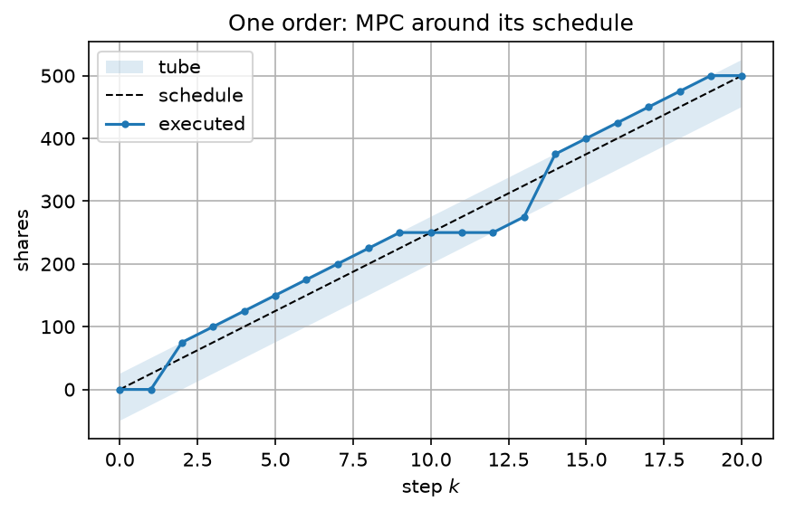
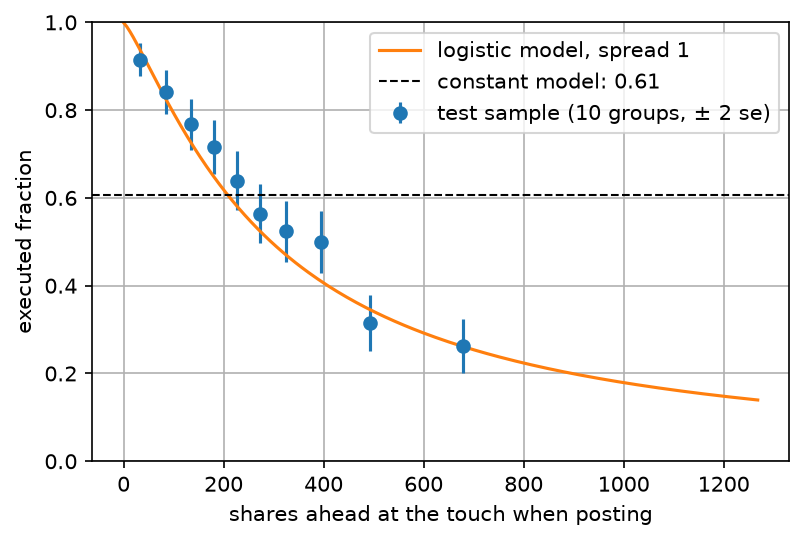
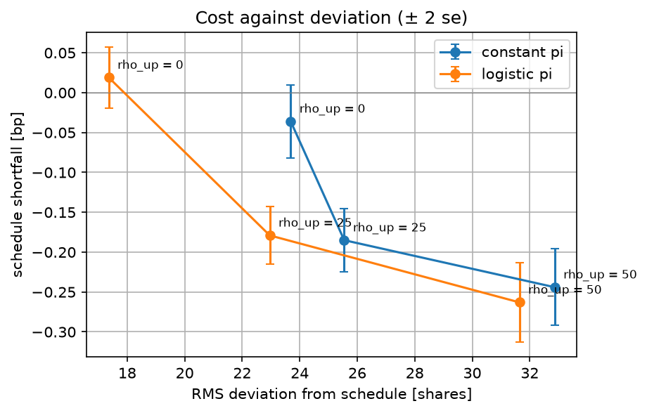
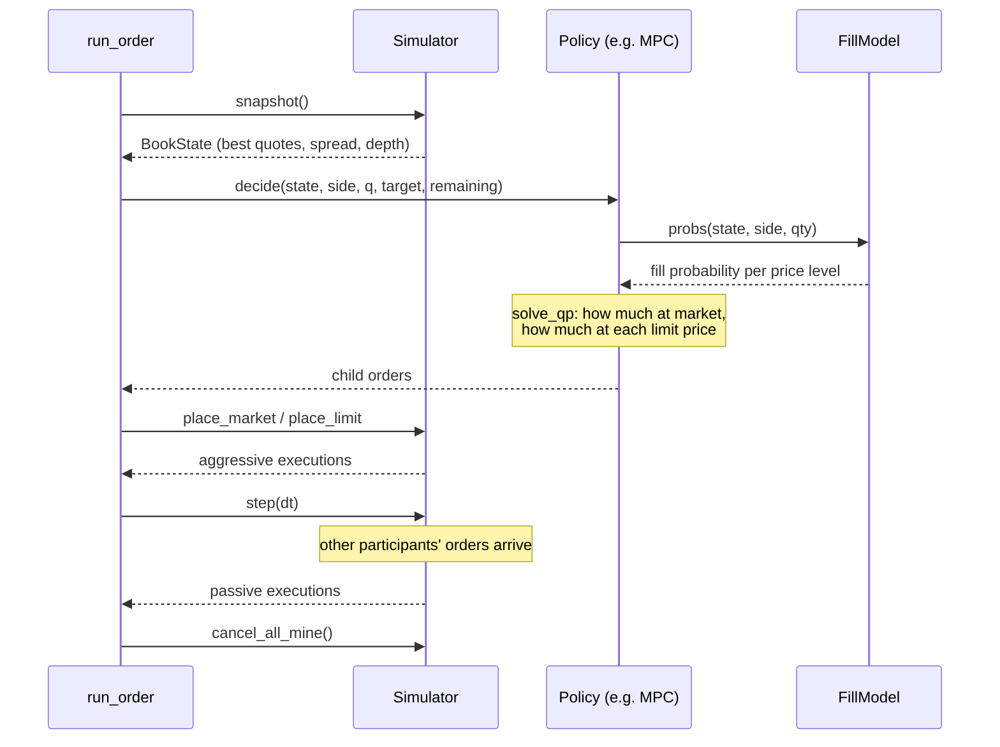

# mpc-execution

Model predictive control for trade execution on a simulated limit order book: a Python reproduction and extension of
McAuliffe et al., *Model Predictive Control For Trade Execution* (2026, [arXiv:2603.28898](https://arxiv.org/abs/2603.28898)).

The problem is how to buy or sell a large quantity of a stock over a fixed time, cheaply and on schedule. The paper
follows a schedule (TWAP, VWAP) with a small quadratic program solved at every decision time, which splits the next
slice between market orders, certain and expensive, and limit orders, cheap and uncertain. The program needs one input
from outside: the probability that a limit order is filled before the next decision.

This repository builds everything needed to study that algorithm, from scratch: a limit order book with price-time
priority, a stochastic order flow that moves it, the execution loop and its cost measures, the quadratic program, two
models of the fill probability, and a rule-based baseline. Then it asks three questions.

1. What does the controller gain over paying the spread at every step?
2. Does the optimisation do anything a simple rule could not?
3. What is a better fill-probability model worth?

## Results

200 parent orders of 500 shares, each executed in 20 steps on a TWAP schedule, in independent simulated markets with the
same seeds for every policy. One tick is one basis point (bp) of the price. A positive number is a cost, so lower is
better; figures are mean ± standard error.

| | Crossing | MPC, constant fill probability | MPC, fill model that reads the book |
|---|---|---|---|
| Schedule shortfall (bp) | +0.57 ± 0.01 | −0.19 ± 0.02 | −0.18 ± 0.02 |
| Arrival slippage (bp) | +1.00 ± 0.24 | +0.45 ± 0.20 | +0.48 ± 0.21 |
| Shares executed passively | 0% | 87% | 82% |
| RMS deviation from schedule (shares) | 0 | 25.5 | 23.0 |
| Decision times with forced market orders | n/a | 8.8% | 2.9% |
| Completion | 100% | 100% | 100% |

*Crossing* sends each slice as a market order. *Schedule shortfall* is the average price paid against the price of
following the schedule exactly at the mid; it is the cleanest measure of execution cost, and the one on which the paper reports its main result.

**1. Trading passively inside a tolerance around the schedule is worth 0.75 ± 0.02 bp.** Crossing pays 0.57 bp to
trade; MPC is paid 0.19 bp. It captures 0.38 bp of spread and gives back 0.20 bp as timing cost: passive orders fill
when the price is coming towards them and miss when it is moving away. That is adverse selection, and here it is purely
mechanical, because nobody in the simulator is informed.

**2. With a constant fill probability and the settings used here, the quadratic program is exactly a two-threshold
rule.** "Send to market whatever exceeds the tolerated delay; post the rest at the best quote" fits in ten lines, uses
no model and no solver, and makes the same decision as MPC in 4,000 cases out of 4,000 (`ThresholdRule`, tested step by
step). The solution sits on the same corner of the feasible set at every step. It leaves that corner when the fill
probability changes from step to step, or when the penalty on schedule deviation is raised: the program then moves
part of the order behind the best quote.

**3. A constant fill probability is right on average and wrong at almost every step.** At the best quote it is 0.61 on
average, but 0.88 with a short queue ahead and 0.21 with a long one. A logistic model of the queue, the price level and
the spread removes 18% of the squared prediction error on a simulation it has never seen, and stays calibrated inside the control
loop (the controller expects 51% of its passive shares to fill and gets 52%; with the constant it expects 61% and gets
between 46% and 64%, depending on what just happened).

**4. The better model does not make execution cheaper. It makes it more controlled.** At the same settings the cost
changes by +0.007 ± 0.022 bp. What changes is how the schedule is followed: the deviation falls by 10%, and the time
spent at the edge of the tolerance, where market orders are forced, falls by two thirds. Compared at equal deviation,
the model is worth about 0.1 bp. Knowing that an order will not be filled does not make it cheaper to fill: the
alternative is a market order, which pays the spread now instead of later.

Read together: the structure of the policy is worth 0.75 bp, the width of its tolerances 0.2–0.3 bp, and the
refinement of its main input about 0.1 bp.

<p align="center">
  
  
</p>
<p align="center">
  
</p>

*Top left: one order, executed by MPC inside the tolerance band ("tube") around its schedule. Top right: the fraction of
a limit order that is filled, against the shares queued ahead of it; the dashed line is what a constant model assumes.
Bottom: cost against deviation from the schedule as the upper tolerance is moved, for the two fill models.*

## How it works

Everything that is measured comes out of one loop, `run_order`. At each decision time:

1. the simulator is asked for a snapshot of the book;
2. the policy receives the snapshot, the quantity executed so far and the schedule target, and returns child orders;
3. market orders are executed at once, limit orders join the back of their queue;
4. the simulated market runs for one step, during which other participants' orders may fill ours;
5. whatever is left of our limit orders is cancelled.

Policies differ only in step 2, and a policy sees nothing but the snapshot.



The code has nine modules, about 870 lines, in `src/mpc_execution/`. They fall into five layers, each of which uses
only the layers beneath it.

| Layer | Modules | What it does |
|---|---|---|
| Market | `book`, `simulator` | An order book with exact matching rules, and a random stream of other people's orders that moves it. |
| Prediction | `fills`, `calibration` | How likely a limit order is to be executed: measured from the market, modelled, and judged. |
| Decision | `policies`, `mpc` | What to send at each decision time. Three policies: `Crossing`, `ThresholdRule`, `MPC`. |
| Experiment | `schedule`, `experiment` | Executes one parent order step by step, and repeats it over many independent markets. |
| Measurement | `metrics`, notebooks | What the execution cost and how far it strayed from the schedule. |

Three parts can be swapped without touching the rest: the schedule (an array), the policy (anything with a `decide`
method) and the fill model (anything with a `probs` method). Each experiment changes one of them and keeps the others,
so a difference in the result has one possible cause.

### The optimisation

With $g$ the gap between the schedule target and the quantity executed, $R$ the quantity left, and one candidate order
per price ($u_0$ a market order, $u_1, u_2, \dots$ limit orders at the best quote and behind it), each step solves

```math
\min_{u \ge 0}\quad \big(\pi \circ (c - \xi)\big)^{\top} u \;+\; \gamma\,\big(\pi^{\top} u - g\big)^{2}
```

```math
\text{subject to}\qquad \mathbf{1}^{\top} u \le \min(g + \rho^{\mathrm{up}},\, R), \qquad u_0 \ge g - \rho^{\mathrm{low}} .
```

Here $\pi$ are the fill probabilities ($\pi_0 = 1$), $c$ the cost of each candidate in spreads (+0.5 for the market
order, −0.5 at the best quote), $\xi$ the cost of leaving a share for later, and $\gamma$ the penalty on the expected
deviation from the schedule. The first constraint keeps the order at most $\rho^{\mathrm{up}}$ shares ahead of schedule
even if everything fills; the second sends to market whatever exceeds a delay of $\rho^{\mathrm{low}}$. Optional
constraints bound the variance of the executed quantity and the size of a single order. The program is written with
`cvxpy` and solved by Clarabel in a few milliseconds.

## The experiments

Each notebook asks one question and ends with numbers. They are meant to be read in order; outputs are committed.

| Notebook | Question | Answer |
|---|---|---|
| [01](notebooks/01_book_sanity.ipynb) | Does the simulated market behave like a market? | For what is needed, yes: a stable book, a one-tick spread 95% of the time, a mid that moves. |
| [02](notebooks/02_crossing_baseline.ipynb) | What does it cost to execute with market orders only? | 0.57 bp of schedule shortfall: half a spread, plus a little. The order never leaves its schedule. |
| [03](notebooks/03_fill_probabilities.ipynb) | How likely is a limit order to be filled? | 61% at the best quote on average, between 21% and 88% depending on the queue ahead. |
| [04](notebooks/04_mpc_vs_crossing.ipynb) | What does MPC gain with a constant fill probability? | 0.75 bp. And its decisions are exactly those of a two-threshold rule. |
| [05](notebooks/05_state_dependent_fills.ipynb) | What does a fill model that reads the book add? | Better predictions and a schedule followed more closely; no lower cost at given settings, about 0.1 bp at equal deviation. |

## Running it

```bash
git clone https://github.com/GioDiSalvo/mpc-execution.git
cd mpc-execution
python -m venv .venv && source .venv/bin/activate
pip install -e ".[dev]"
pytest                    # about 120 tests, about a minute
jupyter lab notebooks     # 01 to 05; each takes up to six minutes
```

Python 3.10 or later; the only dependencies of the package are `numpy`, `pandas` and `cvxpy`. Everything is seeded, so
rerunning a notebook reproduces the committed numbers.

A minimal experiment, MPC against crossing on the same twenty markets:

```python
import pandas as pd
from mpc_execution.simulator import SimParams
from mpc_execution.schedule import twap
from mpc_execution.policies import Crossing
from mpc_execution.fills import collect_fill_samples, LogisticFill
from mpc_execution.mpc import MPC, MPCParams
from mpc_execution.experiment import run_many
from mpc_execution.metrics import summarize

params, dt = SimParams(), 5.0
samples = collect_fill_samples(params, n_levels=3, qty=25, dt=dt, n_trials=2000)   # measure fills in the simulator
fill = LogisticFill.from_samples(samples)                                          # fit the fill model on them

for name, policy in [("crossing", Crossing), ("mpc", lambda: MPC(fill, MPCParams()))]:
    results = run_many(params, policy, dt, twap(500, 20), n_orders=20)
    print(name, pd.DataFrame(map(summarize, results)).schedule_shortfall_bps.mean().round(2))
```

## What is in the repository

```
src/mpc_execution/    the package
tests/                about 120 tests (pytest)
notebooks/            the five experiments, with outputs
figures/              the figures the notebooks produce
DESIGN.md             26 design decisions, each with its reason and its consequence
```

`DESIGN.md` records every choice that is not obvious from the code: why prices are integers, how distances in the book
are measured, why our orders live exactly one step, how policies are compared on the same markets. The notebooks carry
the argument: each states what is expected before a result is shown, and compares the two afterwards.

## Differences from the paper, and limits

- **The market is simulated.** The paper uses six months of NASDAQ order-by-order data. Here the order flow follows the
  model of Cont, Stoikov and Talreja (2010): random arrivals of limit orders, cancellations and market orders, with
  constant rates. There are no informed traders, no intraday volume profile and no latency. This is a choice as much as
  a constraint: in a simulator the true fill probability can be measured, so a fill model can be judged against it.
- **Nobody reacts to our orders.** They consume liquidity and move the price mechanically, but the other participants
  do not change their behaviour in response.
- **Orders live one step.** Unfilled limit orders are cancelled at every decision and posted again, so queue position is
  lost each time. The measured passive fill rates are therefore a lower bound on what a resting order would obtain.
- **The end of the order is exact.** At the last step the whole remainder goes to market, so every policy completes and
  costs are compared at equal completion.
- **One stock, one order size, one step length**, and a fill model fitted and used in the same market. Real markets add
  informed flow on top of the mechanical timing cost measured here, so that cost should be expected to be larger.
- The variance constraint is implemented and tested but not explored in the experiments, and neither is a schedule
  other than TWAP beyond the crossing baseline.

## References

- T. P. McAuliffe, S. Liew, Y. Li, A. Ushenin, C. Wang, A. Tasos, J. Pearce, D. Tasoulis, D. P. Bertsekas, T. Tsagaris.
  *Model Predictive Control For Trade Execution.* [arXiv:2603.28898](https://arxiv.org/abs/2603.28898), 2026.
- R. Cont, S. Stoikov, R. Talreja. A stochastic model for order book dynamics. *Operations Research* 58(3), 2010.
- Á. Cartea, S. Jaimungal. Optimal execution with limit and market orders. *Quantitative Finance* 15(8), 2015.
- R. Almgren, N. Chriss. Optimal execution of portfolio transactions. *Journal of Risk* 3, 2000.
